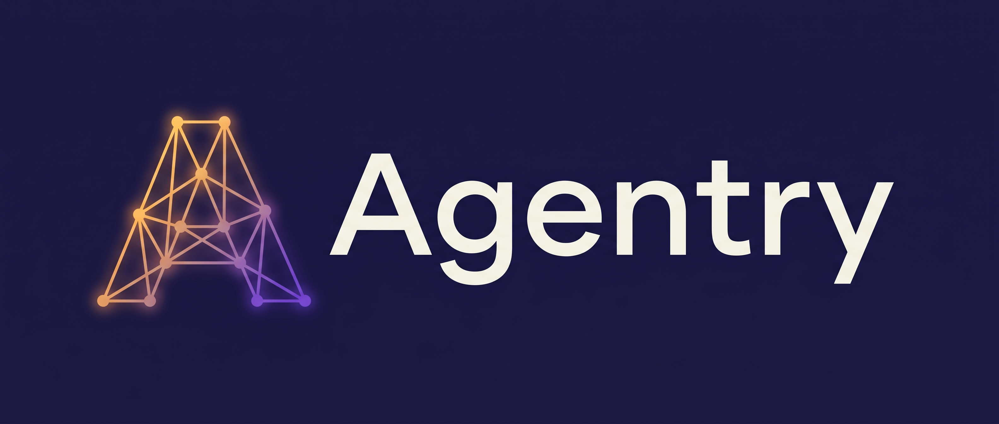
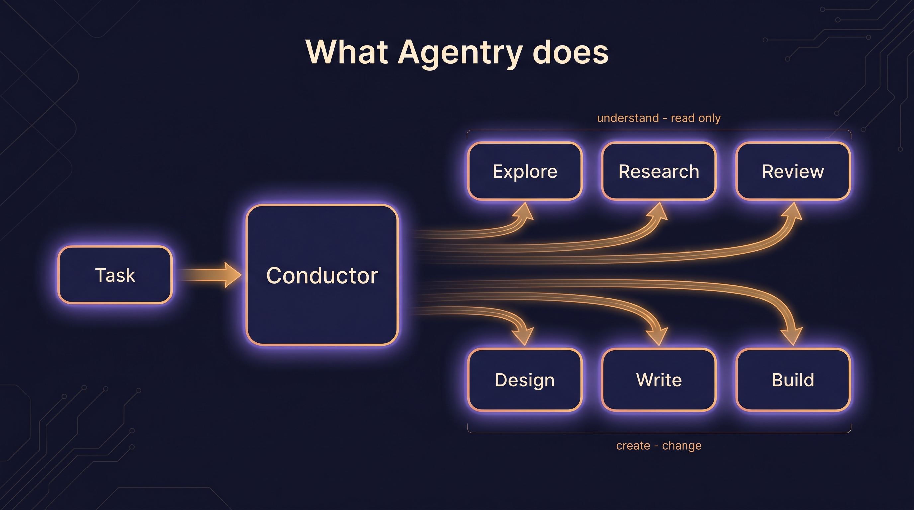
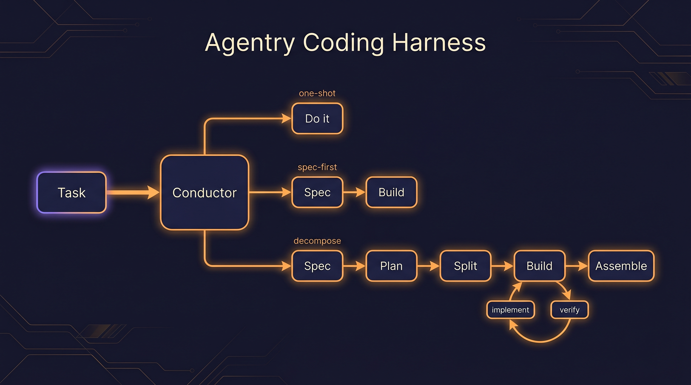

<p align="center">
  
</p>

<p align="center">
  <b>An adaptive agentic layer for Claude Code.</b><br>
  Right-sized orchestration · SDLC specialists · durable memory that compounds.
</p>

<p align="center">
  <code>v0.2 · pre-1.0</code> &nbsp;·&nbsp; <code>Node ≥ 24</code> &nbsp;·&nbsp; <code>MIT</code>
</p>

---

Agentry wraps Claude Code in **right-sized orchestration**, a roster of **SDLC specialists**, and **durable
memory**. You give it a task through one front door — **`/agentry:go <task>`** — and it picks the *least
process that wins*: a one-liner goes straight to a fix; a tangled feature earns a spec, a plan, independent
verification, and a clean merge. The model doesn't change. The conducting, the specialists, and the learning
memory are the product.

<p align="center">
  
</p>

## Install

**Requires Node ≥ 24** — the memory engine uses Node's built-in `node:sqlite` (no native modules, nothing to
compile). From a Claude Code session:

```
/plugin marketplace add silentthreadstudio/agentry
/plugin install agentry@agentry-dev
```

Restart the session — agents, commands, and the bundled memory MCP server load at startup. Then:

```
/agentry:onboard                                       # warm memory on this repo (read-only)
/agentry:go "add pagination to the users endpoint"     # the front door routes and conducts it
```

That's the whole setup.

## How it works — the right-sizing harness

`/agentry:go` routes every task to the **least process that wins**, then conducts it. The conductor (your main
session) is biased to the floor and escalates only on evidence:

| Shape | When it's used | What runs |
| :--- | :--- | :--- |
| **one-shot** | a clear, reversible change with no hidden decision | a single bounded edit, then verify |
| **spec-first** | "done = X" isn't clear yet, or the ask is product-shaped | shape a Spec with observable acceptance criteria, gate it, then build |
| **decompose + verify** | multiple coupled parts, real design forks | spec → plan → split into tasks → build → verify → assemble |

A hidden decision fork vetoes a one-shot; several coupled components earn a decompose. Once work is built and
verified, the last mile has one bar: **done = merged + green.** At each step the conductor dispatches specialist
subagents only when the work earns them, and **gates approvals with you** — you stay in the loop at every fork.

<p align="center">
  
</p>

## The specialists

Each agent owns one slice of the SDLC. Its craft comes from preloaded **skills**, and it is **capability-first** —
no tool allowlists; it uses whatever you have (Serena, web search, a browser MCP) and degrades gracefully when
one's absent. The conductor dispatches a specialist only when the work needs it.

| Agent | Owns |
| :--- | :--- |
| **product-owner** | the *what & why* — turns "make X better" into a Spec with observable acceptance criteria; also docs, READMEs, release notes |
| **architect** | sound structure — module boundaries, ADRs, a Plan with an architecture map, then bounded Task contracts |
| **implementer** | clean, bounded code **and tests** to a Task contract; also the debugging mode (reproduce → fix the smallest thing → prove it) |
| **designer** | UX/UI craft — hierarchy, layout, accessibility, design-system fit — verified against the **rendered** result |
| **verifier** | adversarial, **independent** verification against acceptance + a security lens; returns a Verdict, never fixes |
| **explorer** | read-only comprehension of an existing codebase → a Context map (where things live, conventions, how data flows) |
| **researcher** | investigates genuine unknowns (a library's current API, an external standard) → **cited** findings + implications |
| **librarian** | runs the memory flows — curate, distill (episodes → facts), and *propose* skills (human-gated) |

Every step is also a standalone command (`/agentry:spec`, `/agentry:plan`, `/agentry:implement`, `/agentry:verify`,
`/agentry:ship`, …) emitting one typed artifact. `/agentry:go` chains them for you; you can also drive a single
one by hand — same machinery, one shared contract.

## Architecture

The **repo root is the plugin marketplace.** `plugin/` is the **shipped payload** — installing copies only that
directory, never the dev tree. TypeScript dev packages live under `packages/` and build down into the committed,
zero-install bundles inside `plugin/`.

| Where | What it is |
| :--- | :--- |
| `plugin/` | the **shipped plugin** — `agents/ commands/ skills/` + the committed `mem` bundle |
| `plugin/.claude-plugin/plugin.json` | the manifest — wires the `mem` MCP server inline (`${CLAUDE_PLUGIN_ROOT}/mem/index.js`) |
| `.claude-plugin/marketplace.json` | the marketplace manifest (stays at the repo root; `source: "./plugin"`) |
| `packages/core` | `@agentry/core` — the single typed contract every node shares |
| `packages/memory` | the memory MCP → builds to `plugin/mem/index.js` |
| `packages/web` | the site |
| `packages/eval` | the self-evaluation harness |

## Memory — the moat that compounds (mandatory)

A local, **zero-install** MCP (stdio, `node:sqlite`). **Text files are the source of truth; a derived SQLite index
powers recall.** It's project-rooted with a global root alongside, so facts and episodes follow the work.

Recall is **task-specific** — pulled per task, ranked by relevance × confidence × usefulness, never a session-start
dump. Writes pass a write-bar; stale facts decay; a graduation pipeline turns **episodes → facts → skills**. The
payoff: the second time Agentry meets a decision it settled before, it recalls it, applies it, and routes the task
lighter — spec-first becomes one-shot. **Run #2 is warmer than run #1.**

## Does it work? — yes, and we measure it

Agentry ships a self-evaluation harness that scores its own routing, decision quality, and memory-compounding —
every number gated by controls and read from real work artifacts, never a proxy. Reproduce it yourself:

```bash
pnpm install                                   # at the repo root (the packages are a pnpm workspace)
pnpm --filter @agentry/core build              # @agentry/eval imports the built contract
pnpm --filter @agentry/eval selfeval run bench --fixtures-dir fixtures/bench --plugin-dir ../..
pnpm --filter @agentry/eval selfeval replay <run-id>    # offline re-analysis of a stored run — zero API
pnpm --filter @agentry/eval selfeval report <run-id>    # → a self-contained dashboard HTML
```

`--plugin-dir` is the Agentry **repo root** (the folder that holds `plugin/`); the bench starts `claude` with
`--plugin-dir <repo-root>/plugin`, and refuses to run if that folder has no `plugin.json`. Paths are relative to
`packages/eval`.

> **Read this before `run bench`.** It runs `claude -p` with `--permission-mode bypassPermissions` on **your own
> machine**: the conducted model can read and write files and run commands without asking. Each task runs in a
> fresh temp directory, but nothing sandboxes the process from the rest of your system, and every conduct and
> judge call spends real API credit (`--budget-usd <n>` stops new tasks past a cap). Run it only on a machine and
> account you are comfortable with that. `replay` and `report` make no API calls.
>
> **Earlier results.** Bench results recorded before this fix ran without the Agentry plugin: `claude` was started
> with the repo root, not `plugin/`, so no `agentry:*` subagents or `mem` server were loaded. Do not quote them
> as measurements of Agentry.

One conducted run per fixture yields every axis — decision quality, code correctness, honesty/overclaim, and
escaped defects — so the probes share a run instead of each paying for their own.

## Repo layout & dev

```
plugin/            the shipped plugin (agents · commands · skills · mem)
packages/          TypeScript dev sources (core · memory · web · eval)
```

Two standing rules if you hack on the bundles: any change to a `packages/*/src` that ships must rebuild and commit
its `plugin/` dist in the same change (**dist-lockstep**), and `node scripts/check-plugin.mjs` must pass before
every commit. See [`CONTRIBUTING.md`](./CONTRIBUTING.md) for the full dev setup and the bar a change is held to.

## Maturity & license

**v0.2, pre-1.0.** The shape is settled and the core paths are exercised, but contracts can still change between
versions. Use it, file issues, expect some churn.

MIT.
